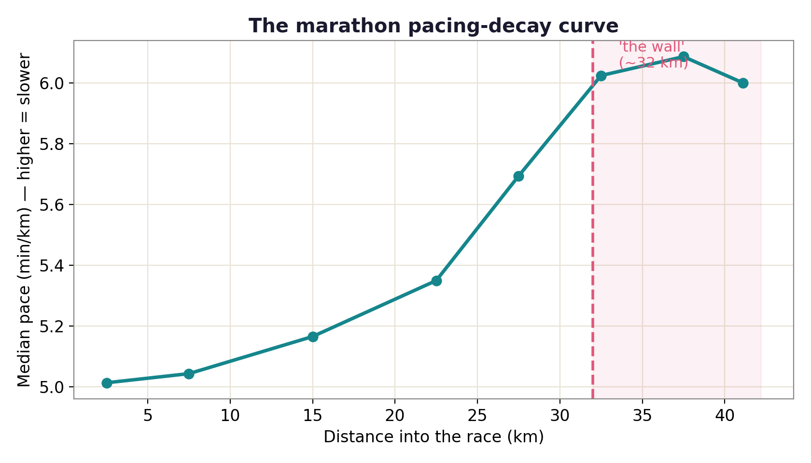

# Hitting the Wall: the marathon pacing-decay curve

Where does a marathon field slow down? This repo measures it from the 5 km splits of 31,655 finishers of the 2014 Boston Marathon; the answer is a bend that starts after 25 km.

[Live site](https://lyhjeremy.github.io/marathon-pacing-decay/) · [Write-up](https://lyhjeremy.github.io/marathon-pacing-decay/overview/)

Design and copy follow [these standards](https://github.com/lyhjeremy/lyhjeremy/blob/main/DESIGN_STANDARDS.md).

## Results

- Median pace is close to flat through 20 km (+2.4% against the 5 to 10 km pace), then rises to +12.9% at 25 to 30 km and +19.4% at 30 to 35 km.
- The median runner's 35 to 40 km pace was **15%** slower than their own 10 to 20 km pace.
- **27%** of finishers slowed by more than 25% on that comparison.
- Runners under 3:00 stay close to flat; runners over 4:30 slow by 30% or more late in the race.



| Segment | Median pace (min/km) | vs 5 to 10 km |
|---|---|---|
| 0–5 km | 5.01 | −0.6% |
| 5–10 km | 5.04 | 0.0% |
| 10–20 km | 5.17 | +2.4% |
| 20–25 km | 5.35 | +6.1% |
| 25–30 km | 5.69 | +12.9% |
| 30–35 km | 6.02 | +19.4% |
| 35–40 km | 6.09 | +20.7% |
| 40 km–finish | 6.00 | +19.0% |

From `tables/segment_pace.csv`.

## Method

- Cumulative split times (decimal minutes) at 5, 10, 20, 25, 30, 35 and 40 km and the finish. Runners are kept only if every split is present and strictly increasing.
- Segment pace is segment time divided by segment distance. The field curve is the median pace per segment.
- Late slowdown is a within-runner ratio: each runner's 35 to 40 km pace against their own 10 to 20 km pace, so each runner is their own baseline.
- Finish-time groups (sub-3:00 through over 4:30) are compared against each group's own 5 to 10 km pace.

Stack: Python, pandas, NumPy, matplotlib.

## How to run

```bash
pip install -r requirements.txt
python fetch_data.py     # downloads 2014 Boston results to data/ (git-ignored)
python analyze.py        # writes figures/ and tables/
```

## Repo layout

| Path | Contents |
|---|---|
| `fetch_data.py` | Downloads the 2014 results CSV |
| `analyze.py` | Computes segment paces, writes the three figures and two tables |
| `tables/` | `segment_pace.csv` (median pace per segment), `summary.csv` (sample size, slowdown metrics) |
| `figures/` | Pace curve, curves by finish-time group, slowdown histogram |
| `index.html`, `overview/` | The GitHub Pages site |
| `writeup.md` | Short write-up |

## Limitations

Split data shows where the field slows but can't tell glycogen depletion, muscle damage, heat and a fast start apart as causes. Boston's Newton hills (about 26 to 34 km) sit on the steepest part of the curve, and the net-downhill opening makes early pace look quicker, so some of the shape belongs to the course. This is one race in one year. `analyze.py` labels its figure's wall at 32 km; the table puts the steepest rise between 25 and 35 km.

## Data

Official 2014 Boston Marathon results via the public mirror [llimllib/bostonmarathon](https://github.com/llimllib/bostonmarathon). Companion study on the same field: [The Negative-Split Myth](https://github.com/lyhjeremy/marathon-negative-split-myth).

## License

[MIT](LICENSE) © 2026 Jeremy Lee
